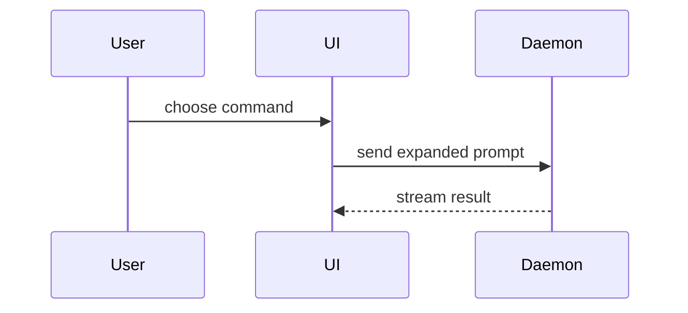

Help the user understand the current topic of conversation visually. Skip the preamble and keep prose brief. Pick the smallest view that makes the key point clear.

- Show logic or an algorithm as pseudocode:

```text
on(save)
  if content is unchanged
    return cached result
  write new content
  return fresh result
```

- Show runtime control flow as a call tree:

```text
submitForm
  createSession
    persistPrompt
    launchAgent
  navigateToSession
```

- Show UI structure as a component tree, including state and module boundaries that matter:

```tsx
<SessionPage> (apps/example/src/routes/session.tsx)
  useSessionEvents()
  <SessionToolbar>
    <RunSkillButton> (packages/ui)
```

- Show file responsibility or a broad refactor as a shallow file tree:

```text
src/
├── commands/       # parses user actions
├── sessions/       # owns session state
└── transport/      # sends API requests
```

- Show component interaction, control flow, or data flow with Mermaid:



- Use `diff` when the point is what changes and the surrounding shape already exists. Match the diff shape to the topic.

For a component change:

```diff
 <SessionPage>
   useSessionEvents()
   <SessionToolbar>
+    <RunSkillButton />
   <SessionTimeline>
+    <SkillResultCard />
```

For a file-layout change:

```diff
 src/
 ├── commands/
+│   └── show-me.ts       # expands the slash command
 ├── sessions/
-└── transport.ts
+└── transport/
+    ├── client.ts
+    └── stream.ts
```

For a call-tree or call-stack change:

```diff
 submitForm
   createSession
     persistPrompt
+    expandSkillMention
     launchAgent
-  navigateToSession
+  navigateToSession
+    subscribeToEvents
```

For a state or control-flow change:

```diff
 on(save)
-  write content
+  if content is unchanged
+    return cached result
+  write new content
+  invalidate cache
```

- Show the whole block when most of it is new, when omitted context would hide ownership or order, or when the user needs a copyable target shape:

```ts
function expandSkill(command: string): string {
  const skillName = command.slice(1)
  return `use the ${skillName} skill`
}
```

- For a visual UI, layout, state comparison, or concept too dense for Mermaid, make one focused HTML artifact. See [Richer artifacts](#richer-artifacts).

### guidance

Place each visual next to the short text it supports. Keep only the calls, files, props, states, and boundaries needed to answer the user's current question or the options to resolve the current discussion point.

You may use one of these, you may use several, it is unlikely you will use all of them. Use your judgement and don't overwhelm the user.

## Richer artifacts

When a concept needs to be touched, read end to end, or played, an HTML artifact beats an in-chat sketch. Pick the form by what the user has to do with it:

| Form | Use when the user must | Built as | Guide |
| --- | --- | --- | --- |
| Interactive visual | step through, drill into, or change a parameter and watch the result | single file | [interactive-visual.md](references/interactive-visual.md) |
| Blog | follow an argument from start to finish, with live figures | single file | [blog.md](references/blog.md) |
| Game | build intuition through a goal, rules, feedback, and a score | workbench | [game.md](references/game.md) |
| Experience | play a role with real material and make judgment calls | workbench | [experience.md](references/experience.md) |

Before building, read [building.md](references/building.md) and the chosen form's guide completely. Do not load the other guides.

Offer before building. In-chat sketches need no offer, but propose every HTML artifact in one line ("want an interactive version of this?" or "want to play this as a game?") and build it only on a yes. Skip the offer when the user already asked for the artifact, or when the calling workflow requires one at that moment, as a learning session does. Games and experiences cost the most, so offer them only when intuition or practice is the goal.

For a product's own UI, layout, or state, match that product's colors, type, spacing, and components, and use its real labels and data. Everything else uses the house style.

### House style

The house style is dark-first engineering editorial: the look of good developer docs and engineering blogs. Near-black canvas, a clean grotesk body, tight display type, a mono voice for metadata, hairlines instead of boxes, and one pink signal accent. Light is a remembered toggle. It lives in `assets/house-tokens.css` (colors, type, space) and `assets/house-base.css` (components and frames), and [house-style.md](references/house-style.md) records why. Use it by default so artifacts read as one body of work. Depart from it when a topic's own theme serves the idea better, such as a game with its own world, and say so.

### Make it fast

- Start every single-file artifact with `python3 scripts/artifact.py new <out.html> --title "..." --layout page|map|blog` from this skill's directory. `page` is one idea in one column; `map` is a docs-style topic map with a territory tree drawn from its sidebar; `blog` is an engineering-blog article with a gradient hero and an "On this page" rail. The house style and behaviors come inlined. Fill in the content; do not rebuild the frame.
- Build games and experiences in the shared workbench with `python3 scripts/artifact.py workbench ...`. It installs once per machine, only after the user approves the download. Each artifact keeps its own source.
- Use only the pinned libraries listed in the building guide. Never add an unpinned or unlisted script URL.

### Check before showing

Open every rich artifact following `$browser-workflow` and capture it at desktop and phone widths, in light and dark. Fix console errors, clipped or overlapping text, unreachable controls, and figures that only make sense after reading the caption, then show it. If no browser is available, say the artifact is unchecked.

### Where it goes

Write artifacts to scratch unless the caller names a home for them. When one is kept, a workbench artifact's `src/` stays next to its built HTML so it can be reopened and improved. Publish a hosted page only when the user asks, through the runtime's artifact publishing if it has one. Single-file output already fits that allowlist, and workbench output inlines everything except its Google Fonts stylesheet.
